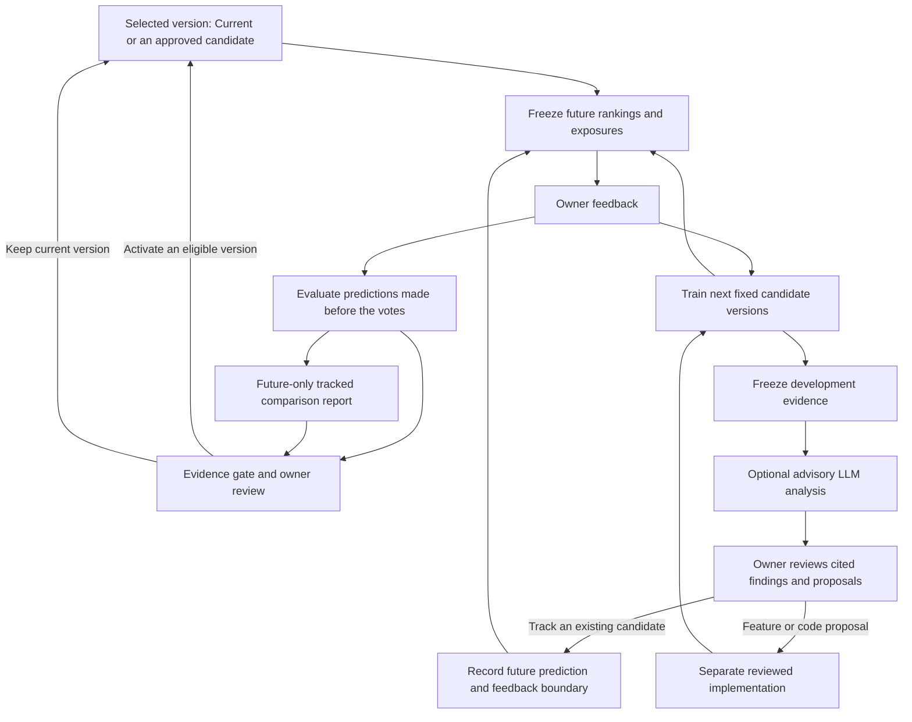

# Taste learning and evaluation

Implemented in the working tree, 25 October 2026. Open **Collection tools → Learning and evaluation** (`/tools/learning`). The hosted learning tables and RPCs were confirmed live on 25 October, including signed-out denial and matching reads from two independent owner sessions. Physical-phone delivery and the released app flow remain separate verification work. Current stays selected until a candidate passes the gate and the owner activates it.

## What feedback means

**Not for me** immediately hides the exact piece. Add reason in the Undo notification is optional; Hidden pieces also offers later editing. Undo and Restore remove the active hide contribution. They do not add an opposite training gradient. Unsave removes a positive example; Skip and unrated pieces remain neutral.

| Judgment | Reason-aware taste training |
|---|---|
| Save / private Would save | Positive, while active and not hidden |
| Not my style | Explicit negative |
| Not the right material / Not the right colour | Explicit but narrow: only the `material:` or `color:` trait of that piece counts as a dislike (and needs the usual two hides to affect ranking). No brand penalty, and not a taste-negative training label |
| Too expensive | Retained price/context evidence, excluded from taste-negative labels |
| Not needed / Already have something similar | Retained owner context about need, not about the piece. Excluded from taste-negative labels and from ranking: owning something similar says nothing against the piece, the brand or the style |
| Incorrect size/category | Retained owner report, excluded from taste-negative labels; provider facts stay intact |
| No reason | Unknown motive, excluded from taste-negative labels |

The new `reason-aware-v1` candidates remove price features. A learned affordability adjustment is deferred until there is supporting evidence. Current preserves the compatibility policy for older reasonless hides; new unspecified/price/data hides do not add a broad taste penalty. Brand exclusion remains an explicit hard preference.

## Delivery and privacy

The browser writes each feedback operation to its own localStorage outbox entry with a stable UUID, then sends it serially. Acknowledgements remove only that operation. Offline operations survive reload; separate entries prevent another tab's append/ack from overwriting them. Retry is free feedback delivery, never a retry of collection or translation. The UI shows pending delivery rather than claiming learning is synced.

Feedback made while account identity is being resolved is staged in a tab-session scope, retained across reload. It moves to the confirmed identity only when the previously known account matches (or this session had no prior account). It is not flushed to an unverified account. Browser storage must be available; a storage error is shown and the learning operation cannot be guaranteed durable.

`/api/learning` requires owner access, same-origin JSON for mutations, bounded inputs and trusted listing snapshots. Local mode uses `.forme-data/learning.sqlite`. Account mode uses owner-only Supabase tables/RPCs from `supabase/migrations/20261025000000_learning.sql`. Signed-out/non-owner hosted callers cannot read or write the journal. Collection credentials are not involved.

The immutable journal is canonical for learning; active examples are derived by replay. Profile preferences remain a compatible working copy using the existing revision-protected sync path, not a second atomic write in the journal transaction. Profile sync now requeues edits made during an in-flight save and only clears dirty state after the newest state is acknowledged.

Shopping and private-preview channels stay separate. Legacy ranking-preview/study files are not imported. A private-preview-trained candidate requires explicit consent before Discover can use it; preview votes never become actual saves/hides.

## Frozen predictions and local training

Discover records a frozen pool and all four candidate orderings before later feedback. Visibility uses a 50% card intersection and records the route and card position within its grid/rail; giving feedback explicitly also records the piece as seen, without inventing a missing position. Preview decisions record the selected engine and displayed position. Unseen/rendered inventory is never labelled negative. Snapshots preserve item/price/provenance/observation data, filters, policy, model identifiers and the training cutoff. Unavailable prior predictions stay unscored.

Learning runs on the owner's computer, after a short queued delay or **Train next candidates**. It rebuilds from canonical active examples and tests exactly three allow-listed candidates: River 0.26.1 logistic regression (`l2=0.01`), the same River model with conservative regularization (`l2=0.1`), and Gorse 0.5.11 tags/factorization machines with collaborative filtering disabled and `read_feedback_types=[]`. The existing setup command is `npm run recommendations:setup`. An interrupted local training lease becomes recoverable after 150 seconds; queued work can be prepared again. Missing tools, insufficient labels, invalid rankings and partial unseen coverage are disclosed; they never count as learned evidence.

Gorse normally omits training-seen pieces. Those retain a disclosed fallback order; evaluation excludes training identities. A run is only considered learned when unseen eligible coverage is complete. All candidates reorder the same pool. Training never blocks hiding a card or reshuffles the comparison being rated. A Discover visit retains its prediction pool across feedback, so later positive/negative judgments remain comparable. Re-entering Discover or changing inventory/eligibility starts a fresh pool that can use the next model version. Selection validity is still checked after corrections. Model selection is pinned and never automatically follows later training runs.

Model recipes/output stay private under `.context/recommendation-learning/`. Stored metadata includes canonical training identities/digests, cutoff, feature/label versions, source/filter hashes and engine orders. Changed/withdrawn training labels invalidate a selected version; changed inventory or hard preferences fall back to Current until a compatible version is explicitly selected. Application eligibility filters always run before applying any learned order. Card explanations distinguish Current preference context from learned ordering; they do not invent native-model explanations.

## Evidence and activation

Reports score positive-versus-explicit-style-negative pairs judged within a frozen run, using predictions produced before either judgment. They exclude training identities, missing exposure/predictions, price/data rejections and unknown motives. Repeated delivery and repeated judgments on the same item do not create independent evidence. Reports for shopping and preview remain separate.

The initial, fixed screening gate requires, **per candidate**:

- At least 20 scored decisions, including 5 positives and 5 style negatives.
- At least 20 within-pool positive/negative pairs across 5 different server-recorded exposure days.
- A mean daily ordering gain of at least 0.05 over Current and a positive conservative lower bound (`mean − 2.776 × SE` across daily gains).
- A genuinely learned, unmodified-policy candidate with current training labels.

This is a screening policy, not a calibrated guarantee or full-feed accuracy estimate. Exposure/position selection bias remains; five days from one owner are correlated personal evidence. The UI reports insufficient evidence rather than a winner when requirements fail. Same-pool reranking does not establish retrieval superiority. The existing separate blind preview remains available; independently randomized discovery experiments are future work.

Passing the gate enables **Review activation**, then a confirmation pins the exact version. Preview-trained versions additionally require the consent checkbox. The API independently enforces the gate and optimistic selection revision, rejecting stale-tab selection. **Return to Current** is always available. No automatic promotion, code-writing agent, LLM taste judge or routing change is part of this loop. The separately approved [advisory analyst](learning-analyst.md) is implemented with its provider unconfigured; it cannot select an engine or make calls merely by browsing/training.

## The loop continues after review

Selection is not an endpoint: it determines later rankings. Feedback evaluates what was shown before it can train a subsequent version. Keeping the current version also continues generating evidence. A frozen visit is not reordered mid-review, and the selected version never follows new training automatically.

The analyst uses development evidence already represented in training, not future validation answers. Its proposals can start a tracked comparison only after owner review. That comparison excludes existing predictions and votes, so explaining an old benchmark cannot certify a new candidate. Code/feature proposals require implementation and testing before entering the candidate loop. Collection and translation supply upstream data through their existing manual authorization flows; neither is required or triggered by this cycle. See [analyst workflow and safeguards](learning-analyst.md).

## Export, deletion and verification

**Download private learning history** exports events, exposures, frozen contexts/runs, selection audit history and local analyst artifacts. Existing local backup tooling already includes every `.forme-data/*.sqlite` file via consistent SQLite snapshots, including both journals. Model-process scratch files are not part of that backup; frozen recipes/orders remain in the journal. Hosted journals need their own account/database backup arrangements.

**Delete learning history** explicitly clears this owner's journal/selection, local analyst artifacts and recorded local model-run directories, returning to Current. Minimal analysis billing reservations remain to preserve spending limits; an in-progress analysis blocks deletion. Actual preferences/saves/hides and separate legacy studies remain. Previously downloaded exports, device outboxes and independent backups are separate copies; deleting the active journal does not erase them. Resolve pending feedback before deletion; other devices can still submit their own queued operations.

Relevant checks: `npm run typecheck`, `npm run test:unit`, `npm run test:recommendations`, `npm run build`, and `npm test -- tests/e2e/learning.spec.ts tests/e2e/listing-feedback.spec.ts`. Tests use isolated fixtures and no provider credits. Database access tests execute the actual migration with PGlite; that does not establish it is deployed to Supabase. See [project state](project-state.md) for dated verification and [original plan](recommendation-learning-plan.md) for rationale/deferred extensions.
